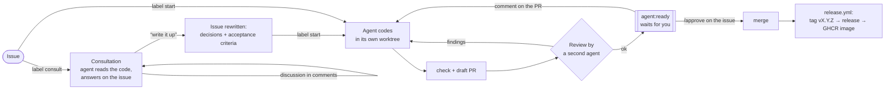
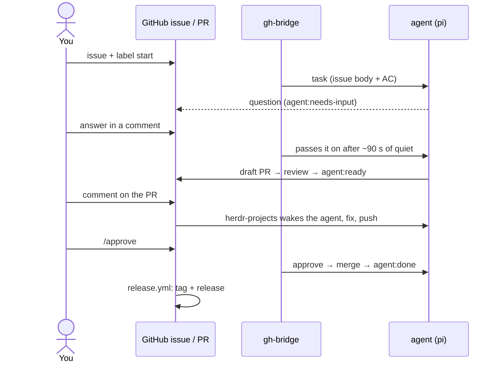

# autonomous

**A GitHub issue → an agent on your VPS writes the code, tests it, opens a PR, gets reviewed by a second agent and waits for your `/approve` → merge → tag and release.** Many repos at once, from one server. Plus a **consult** mode: first you talk the product and the code through with an agent, then one label sends it to be built.



New to this? Start with **[CHEATSHEET.md](CHEATSHEET.md)** (one A4 page).

Tested end-to-end on Ubuntu 24.04 (Lima VM, arm64), on two repos:
- tasks in parallel,
- the agent asks → you answer on the issue,
- fixes from a PR comment,
- consult → `start`,
- `/approve` and a manual merge,
- a machine reboot.

## What it's built from


| Part | Role |
|---|---|
| [herdr](https://herdr.dev) | terminal server for agents: sessions live in the background, you can attach over SSH and watch an agent |
| [herdr-projects](https://github.com/eliasstravik/herdr-projects) | herdr plugin: board, multi-repo, a worktree per task, check, draft PR, review by a second agent, merge only after approval, reacts to PR comments, `--chat` mode (consults). Pinned to 1.2.27: its successor Shepherdr 2.0 renamed the CLI and data dir, and the bridge speaks 1.2.x |
| [pi](https://github.com/earendil-works/pi) | the coding agent |
| [OpenRouter](https://openrouter.ai) | models, `deepseek/deepseek-v4.1-flash` by default (cheap; one line to change) |
| `gh` | GitHub CLI |
| **gh-bridge** (`bridge.py`) | joins issues to the board: `consult`/`start` labels → tasks, issue comments → agent, state → `agent:*` labels, `/approve`, `/stop` |
| **repo-kit** | for each repo: issue/PR templates, `AGENTS.md` (Definition of Done), `Makefile`, check + release workflows |

## TL;DR: VPS setup

You need a VPS with Ubuntu 22.04+ / Debian 12+ (x86_64 or arm64), 2+ GB RAM, and `root` or a user with sudo.

```bash
git clone https://github.com/worotyns/autonomous && cd autonomous
cp config/autonomous.example.toml config/autonomous.toml   # [[repo]] with your repos, [git] name/email
cp config/env.example config/env                           # OPENROUTER_API_KEY, GH_TOKEN
./deploy.sh root@<vps-ip>                                  # or ubuntu@<ip>; optionally --tailscale
```

Once on the VPS (herdr-projects needs each agent started by hand once):

```bash
sudo -iu agent
cd ~/repos/<owner>/<repo> && pi     # does it answer? quit (ctrl+c)
```

Add the repo-kit to each repo (opens a PR, overwrites nothing):

```bash
repo-kit/apply.sh owner/repo1 owner/repo2
```

In that PR, fill in `Makefile` (`setup`, `check`), the commands and a repo map in `AGENTS.md`, and the check command in `.herdr-projects.json`. A cheap model does much better when it doesn't have to guess. The `check.yml` workflow runs the same `make check` as the board and as branch protection.

**Tokens:**
- `GH_TOKEN`: the token of the account whose comments steer the agent (usually yours). Best fine-grained, only for the chosen repos: Contents, Issues, Pull requests (RW), Actions, Commit statuses, Metadata (R).
- `OPENROUTER_API_KEY`: a separate key with a credit limit.

## Day to day



| I want to | I do |
|---|---|
| talk an idea through before building it | issue + label `consult` → discuss in comments → “write it up” → label `start` |
| hand over a task | issue from the **Agent task** template (concrete acceptance criteria!) + label `start` |
| answer the agent / clarify | comment on the issue |
| get code changes | comments / review on the PR |
| merge | `/approve` on the issue (or merge by hand, that works too) |
| stop it | `/stop` on the issue |
| pick the version bump | label on the PR: `release:minor`, `release:major`, `release:none` (patch by default) |
| watch an agent live | `sudo autonomous attach`; board: `ctrl+b a`, leave: `ctrl+b q` |
| status / logs / health | `sudo autonomous status`, `sudo autonomous logs`, `sudo autonomous doctor` |
| add a repo | `[[repo]]` in `/etc/autonomous/autonomous.toml` → `sudo autonomous update` |
| update | `./deploy.sh <host>` again (idempotent, leaves the config in `/etc/autonomous` alone) |

Labels: `agent:consulting` · `agent:working` → (`agent:needs-input`) → `agent:ready` → `agent:done`, or `agent:failed`.

**Consult model:** `[consult] agent` in the config or `AUTONOMOUS_CONSULT_AGENT` in `/etc/autonomous/env`, e.g. `pi/openrouter/deepseek/deepseek-v4-pro`. A stronger model than the coding one pays off here: little text, a lot of thinking. The other models (agent, reviewer) are in the `[herdr_projects]` section. `pi --list-models` lists the names.

## Self-hosting (dogfooding)

autonomous already carries the kit it installs into other repos: `.herdr-projects.json` (`make setup` / `make check`), `AGENTS.md`, the issue/PR templates and the `check` + `release` workflows. To let the agent work on the project itself, add it as a repo:

```toml
[[repo]]
name = "worotyns/autonomous"
```

Then `sudo autonomous update`, open an issue from **Agent task** and add `start`. `make check` is the same gate locally, in CI and before a PR.

The fast end-to-end loop is a privileged systemd Docker container, no KVM needed:

```bash
tests/docker.sh up                 # install autonomous into a throwaway systemd container
tests/docker.sh scenario work      # the calculator sandbox: issue -> PR -> review -> /approve -> release
tests/docker.sh down
```

The container runs the same `repo-kit`/`make check` as the sandbox repos. That is the inception loop: autonomous develops autonomous, and the container proves the kit on a calculator before a real PR. The calculator sandbox and all scenarios are in [tests/README.md](tests/README.md).

## Test locally (macOS/Linux)

macOS with Lima:

```bash
brew install lima
limactl start --name=autonomous --tty=false --cpus=4 --memory=4 --disk=20 --mount-none template:ubuntu-24.04
# Lima writes the SSH config to ~/.lima/autonomous/ssh.config
SSH_CONFIG=~/.lima/autonomous/ssh.config ./deploy.sh lima-autonomous
# clean up: limactl delete -f autonomous
```

On a Linux host there are two paths:

- **Docker (fast, no KVM):** `tests/docker.sh up` runs a privileged Ubuntu + systemd container, so `install.sh`, `loginctl` and the systemd services work at native speed. It is a container, not a VM; use sandbox repos and `tests/docker.sh down` when done.
- **VM (release-grade):** `scripts/vm.sh` boots an Ubuntu cloud image with QEMU (KVM when `/dev/kvm` works, TCG otherwise), or use Lima when KVM is available. A plain container without systemd won't do.

The calculator scenarios, Docker details and the pre-push checklist are in [tests/README.md](tests/README.md) and [AGENTS.md](AGENTS.md).

## What's where

| | |
|---|---|
| `deploy.sh` | from your laptop: rsync to `/opt/autonomous` + `install.sh` on the server |
| `install.sh` | installer: packages, user `agent`, herdr + plugin, pi, repos, labels, board settings, systemd services |
| `bridge.py` | gh-bridge (Python, standard library only); on the server via `sudo autonomous doctor\|status\|logs\|attach\|restart\|update` |
| `prompts/` | task and consult briefs, messages carrying issue comments |
| `config/` | example config and env; the real ones go to `/etc/autonomous/` |
| `systemd/` | `herdr.service` (`herdr server`) and `gh-bridge.service` |
| `repo-kit/` | files for each repo + `apply.sh` |
| `scripts/vm.sh` | throwaway Ubuntu VM on a Linux host (KVM or TCG) |
| `tests/docker.sh` | privileged systemd container: fast local e2e, no KVM |
| `tests/docker/` | Dockerfile for that container |
| `tests/` | sandbox test config, calculator end-to-end scenarios |
| `.github/` | issue/PR templates, `check.yml`, `release.yml` |

On the VPS: config in `/etc/autonomous/`, bridge state in `/var/lib/autonomous/`, repos in `/home/agent/repos/<owner>/<repo>`, worktrees in `/home/agent/.herdr/worktrees/`.

## Security: read before connecting real repos

- **The agent has a full shell as user `agent`** (pi doesn't ask for permission). Keep no production secrets on this VPS and don't give `agent` sudo.
- **Only trusted people steer it:** PR comments wake the agent only from the `GH_TOKEN` owner; issue comments only from them and from `allow_authors`. `start`/`consult` labels added by anyone else are removed. Comments from others are ignored (prompt injection).
- **Nothing merges without you** (`merge.by = you`, `merge.checks = github`). Also turn on branch protection with required CI.
- Put a credit limit on the OpenRouter key, and `limit.time` per task.

## Known limitations

- Labels catch up with a merge on the next poll (up to ~60 s).
- `release.yml` tags every push to `main`, including commits not made by agents (`release:none` on the PR turns it off).
- Checked on Ubuntu 24.04 x86_64 in a privileged systemd Docker container (install + `work` scenario end-to-end) and on arm64 with Lima. x86_64 Lima should work the same.
- The board plugin is pinned to herdr-projects 1.2.27. Shepherdr 2.0 replaced it with a new CLI (`shepherdr`) and data dir (`~/.shepherdr`); migrating `bridge.py`/`install.sh` is a separate task.
