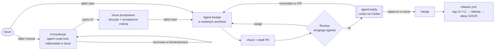
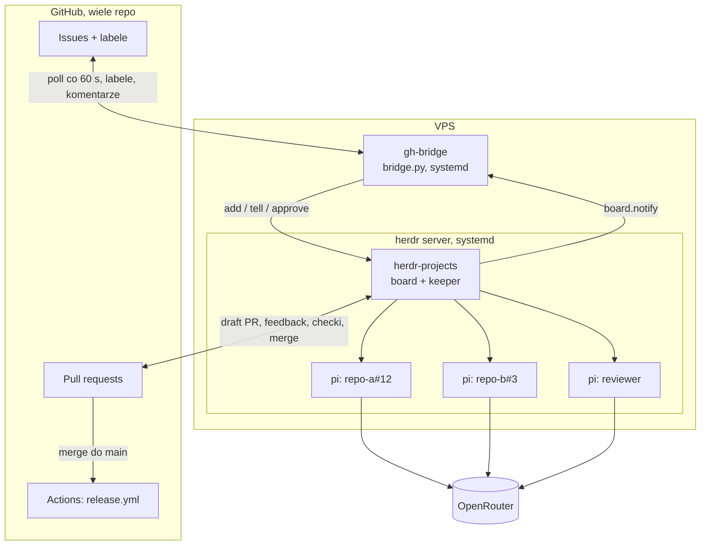
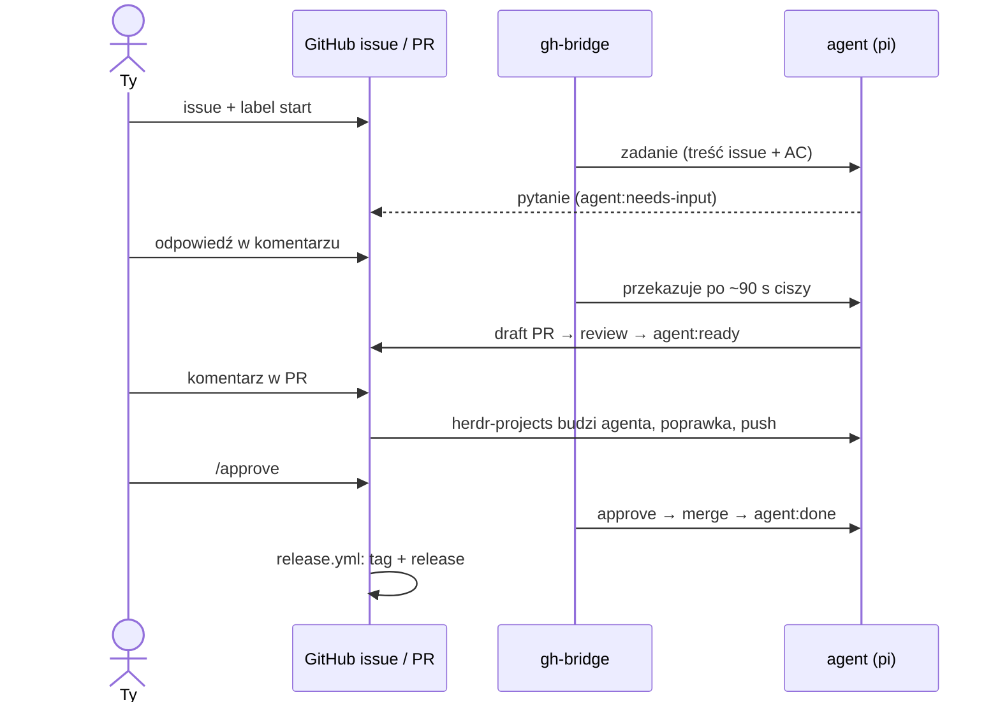

# autonomous

**Issue na GitHubie → agent na Twoim VPS pisze kod, testuje, otwiera PR, przechodzi review drugiego agenta i czeka na Twoje `/approve` → merge → tag i release.** Dla wielu repo naraz, z jednego serwera. Do tego tryb **konsultacji**: najpierw rozmawiasz z agentem o produkcie i kodzie, potem jednym labelem puszczasz to do realizacji.



Przetestowane end-to-end na Ubuntu 24.04 (Lima VM, arm64), na dwóch repo:
- zadania równolegle,
- agent pyta → Ty odpowiadasz w issue,
- poprawki z komentarza w PR,
- konsultacja → `start`,
- `/approve` i ręczny merge,
- restart maszyny.

## Z czego to jest zrobione



| Element | Rola |
|---|---|
| [herdr](https://herdr.dev) | serwer terminali dla agentów: sesje żyją w tle, można się podpiąć przez SSH i podejrzeć agenta |
| [herdr-projects](https://github.com/eliasstravik/herdr-projects) | plugin herdr: board, multi-repo, worktree na zadanie, check, draft PR, review drugim agentem, merge tylko po akceptacji, reakcja na komentarze w PR, tryb `--chat` (konsultacje) |
| [pi](https://github.com/earendil-works/pi) | agent kodujący |
| [OpenRouter](https://openrouter.ai) | modele, domyślnie `deepseek/deepseek-v4.1-flash` (tani; zmiana jedną linią) |
| `gh` | GitHub CLI |
| **gh-bridge** (`bridge.py`) | spina issues z boardem: labele `consult`/`start` → zadania, komentarze w issue → agent, stan → labele `agent:*`, `/approve`, `/stop` |
| **repo-kit** | do każdego repo: szablon issue z acceptance criteria, `AGENTS.md` (Definition of Done), `release.yml` |

## TL;DR: setup VPS

Potrzebujesz VPS z Ubuntu 22.04+ / Debian 12+ (x86_64 lub arm64), 2+ GB RAM, dostępu `root` albo usera z sudo.

```bash
git clone https://github.com/worotyns/autonomous && cd autonomous
cp config/autonomous.example.toml config/autonomous.toml   # [[repo]] z Twoimi repo, [git] name/email
cp config/env.example config/env                           # OPENROUTER_API_KEY, GH_TOKEN
./deploy.sh root@<ip-vps>                                  # albo ubuntu@<ip>; opcjonalnie --tailscale
```

Raz na VPS (herdr-projects wymaga jednego ręcznego startu agenta):

```bash
sudo -iu agent
cd ~/repos/<owner>/<repo> && pi     # odpowiada? wyjdź (ctrl+c)
```

Do każdego repo repo-kit (otwiera PR, nic nie nadpisuje):

```bash
repo-kit/apply.sh owner/repo1 owner/repo2
```

W tym PR uzupełnij w `AGENTS.md` komendy (install, check) i mapę repo, a w `.herdr-projects.json` komendę checku. Tani model działa dużo lepiej, gdy nie musi zgadywać.

**Tokeny:**
- `GH_TOKEN` to token konta, którego komentarze sterują agentem (zwykle Twój). Najlepiej fine-grained, tylko na wybrane repo: Contents, Issues, Pull requests (RW), Actions, Commit statuses, Metadata (R).
- `OPENROUTER_API_KEY`: osobny klucz z limitem kredytów.

## Jak z tym pracować



| Chcę | Robię |
|---|---|
| przegadać pomysł przed realizacją | issue + label `consult` → rozmowa w komentarzach → „spisz to” → label `start` |
| zlecić zadanie | issue z szablonu **Agent task** (konkretne acceptance criteria!) + label `start` |
| odpowiedzieć agentowi / doprecyzować | komentarz w issue |
| poprawki w kodzie | komentarze / review na PR |
| zmergować | `/approve` w issue (albo merge ręcznie, też zadziała) |
| zatrzymać | `/stop` w issue |
| typ wersji | label na PR: `release:minor`, `release:major`, `release:none` (domyślnie patch) |
| podejrzeć agenta na żywo | `ssh` → `sudo -iu agent` → `herdr`; board: `ctrl+b a`, wyjście: `ctrl+b q` |
| status / logi | `sudo -iu agent /usr/local/bin/uv run --script /opt/autonomous/bridge.py status`, `journalctl -u gh-bridge -f` |
| dodać repo | `[[repo]]` w `/etc/autonomous/autonomous.toml` → `sudo bash /opt/autonomous/install.sh` |
| aktualizacja | `./deploy.sh <host>` jeszcze raz (idempotentny, nie rusza configu w `/etc/autonomous`) |

Labele: `agent:consulting` · `agent:working` → (`agent:needs-input`) → `agent:ready` → `agent:done`, albo `agent:failed`.

**Model konsultanta:** `[consult] agent` w configu albo `AUTONOMOUS_CONSULT_AGENT` w `/etc/autonomous/env`, np. `pi/openrouter/deepseek/deepseek-v4-pro`. Warto mocniejszy niż model do kodu, bo tekstu jest mało, a myślenia dużo. Pozostałe modele (agent, reviewer) są w sekcji `[herdr_projects]`. Listę nazw daje `pi --list-models`.

## Test lokalnie (macOS, Lima)

```bash
brew install lima
limactl start --name=autonomous --tty=false --cpus=4 --memory=4 --disk=20 --mount-none template:ubuntu-24.04
limactl show-ssh --format=config autonomous | sed 's/^Host .*/Host lima-autonomous/' > ~/.lima/autonomous/ssh.config.host
SSH_CONFIG=~/.lima/autonomous/ssh.config.host ./deploy.sh lima-autonomous
# sprzątanie: limactl delete -f autonomous
```

Zwykły kontener (Docker/Podman) się nie nada, bo instalator potrzebuje systemd.

## Co gdzie leży

| | |
|---|---|
| `deploy.sh` | z laptopa: rsync do `/opt/autonomous` + `install.sh` na serwerze |
| `install.sh` | instalator: pakiety, user `agent`, herdr + plugin, pi, repo, labele, ustawienia boardu, usługi systemd |
| `bridge.py` | gh-bridge (Python, sama biblioteka standardowa): `run`, `once`, `status`, `doctor`, `sync-repos`, `apply-settings`, `notify` |
| `prompts/` | brief zadania i konsultacji, wiadomości z komentarzami z issue |
| `config/` | przykładowy config i env; prawdziwe lądują w `/etc/autonomous/` |
| `systemd/` | `herdr.service` (`herdr server`) i `gh-bridge.service` |
| `repo-kit/` | pliki do repo + `apply.sh` |

Na VPS: config w `/etc/autonomous/`, stan mostu w `/var/lib/autonomous/`, repo w `/home/agent/repos/<owner>/<repo>`, worktree w `/home/agent/.herdr/worktrees/`.

## Bezpieczeństwo, przeczytaj przed podpięciem prawdziwych repo

- **Agent ma pełny shell usera `agent`** (pi nie pyta o zgodę). Nie trzymaj na tym VPS sekretów produkcyjnych i nie dawaj `agent` sudo.
- **Sterują tylko zaufani:** komentarze w PR budzą agenta tylko od właściciela `GH_TOKEN`, a w issue tylko od niego i od `allow_authors`. Labele `start`/`consult` od innych są zdejmowane. Komentarze obcych są ignorowane (prompt injection).
- **Nic nie merguje się bez Ciebie** (`merge.by = you`, `merge.checks = github`). Włącz też branch protection z wymaganym CI.
- Limit kredytów na kluczu OpenRouter, `limit.time` na zadanie.

## Znane ograniczenia

- Labele po merge'u odświeżają się z pollingiem (do ~60 s).
- `release.yml` taguje każdy push do `main`, także commity spoza agentów (`release:none` na PR wyłącza).
- Sprawdzone na Ubuntu 24.04 arm64 (Lima). Na x86 powinno działać tak samo (instalatory herdr i herdr-projects wspierają oba), ale tego nie testowałem.
